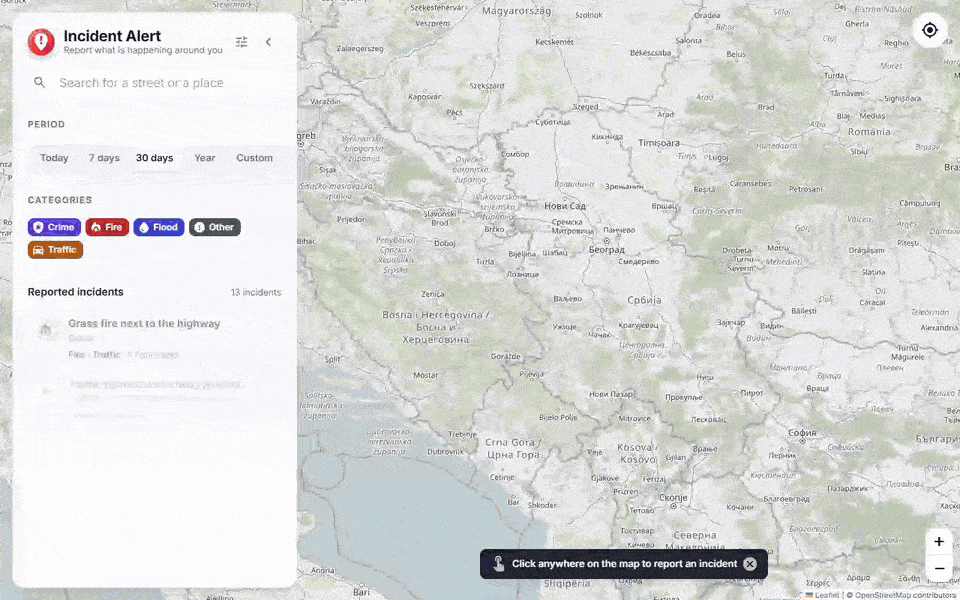
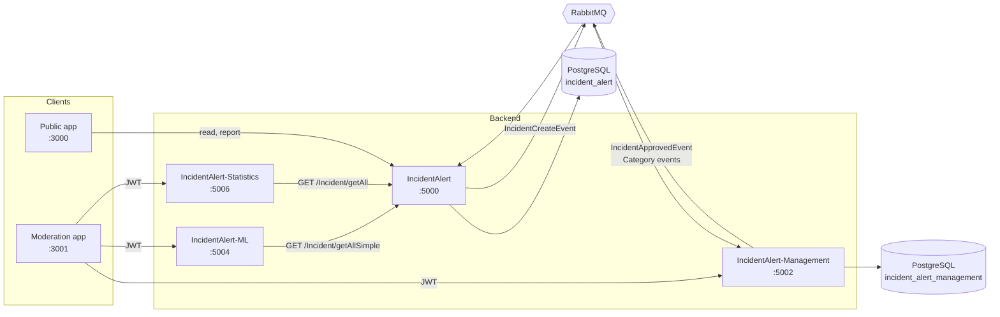
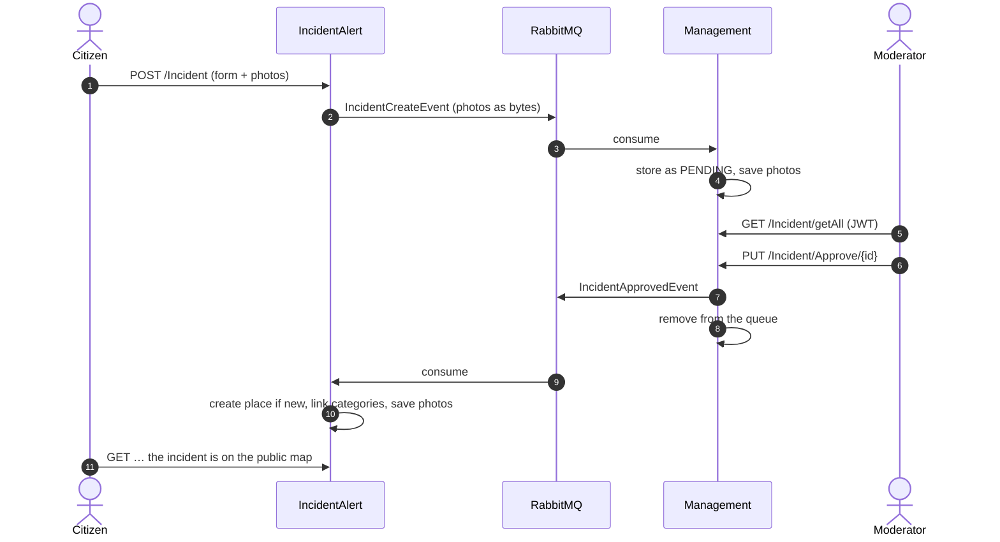

<div align="center">

# 🚨 Incident Alert

[](https://github.com/pero-grubac/IncidentAlert/actions/workflows/ci.yml)


**Microservice backend for citizen incident reports: report on a map, moderate, publish, analyse.**



</div>

---

## 📌 Project Overview

**Incident Alert** lets citizens report incidents (fire, flood, traffic, crime…) at a place on the map, with photos. Every report goes to a moderation queue first. When a moderator approves it, it is published to the public map, counted in the statistics and grouped with similar reports by an ML model.

The system is split over three repositories:

| Repository | What it is | Who uses it |
|------------|------------|-------------|
| **IncidentAlert** (this one) | Four ASP.NET Core services, PostgreSQL, RabbitMQ | — |
| [IncidentAlertFrontend](https://github.com/pero-grubac/IncidentAlertFrontend) | Public React app: map, reports, photos | 🌍 Citizens, no sign-in |
| [IncidentAlertFrontend-Mangement](https://github.com/pero-grubac/IncidentAlertFrontend-Mangement) | Moderation React app: queue, statistics, ML groups, accounts | 🛡️ Moderators and administrators (JWT) |

### Services

| Service | Port | Responsibility | Storage |
|---------|-----:|----------------|---------|
| 📣 **IncidentAlert** | 5000 | Public API: read approved incidents, accept new reports, serve photos | PostgreSQL `incident_alert` |
| 👩‍⚖️ **IncidentAlert-Management** | 5002 | Moderation API: queue, approve / reject / delete, categories, accounts, sign-in (JWT, ASP.NET Identity, Google ID tokens) | PostgreSQL `incident_alert_management` |
| 🤖 **IncidentAlert-ML** | 5004 | Groups published incidents by text similarity (ML.NET text featurizer + k-means). Moderators only. | — (reads the public API) |
| 📊 **IncidentAlert-Statistics** | 5006 | Busiest places and categories for all time, last year, month and week. Moderators only. | — (reads the public API) |

---

## ✨ Features

- 🗺️ **Reports with location and photos**, sent as multipart form data and stored per incident
- 🛡️ **Moderation before publishing**: new reports wait in the Management service until a moderator approves, rejects or deletes them
- 📨 **Event-driven**: reports, approvals and category changes travel between services as MassTransit messages over RabbitMQ, photos included
- 🏷️ **Categories owned by moderators** and replicated to the public service through events
- 🔐 **JWT sign-in** with ASP.NET Identity; the same token is checked by Management, ML and Statistics
- 🧑‍💼 **Accounts need approval**: registering (or a first Google sign-in) creates an account an administrator has to approve before it can moderate
- 🔑 **Google sign-in done right**: the API verifies Google's ID token itself (signature, audience, expiry) and accepts only verified addresses of the student domain
- 🤖 **Similar reports** grouped with ML.NET k-means over text features
- 📊 **Statistics** per period: busiest place, busiest place per category, incidents per category
- 🩺 **Health endpoints** (`/health`) on every service, used by Docker and the CI smoke test
- 🛡️ **No secrets in the repository**: passwords and the signing key come from the environment; the services refuse to start with a missing or short key, and with the development key in Production
- 🧪 **94 automated tests**: services against an in-memory database, APIs hosted in memory with a test message bus and a fake Google, and an end-to-end smoke test in CI

---

## 🛠️ Tech Stack

| Technology | Usage |
|------------|-------|
| ASP.NET Core 10 | Four REST APIs |
| Entity Framework Core 10 + Npgsql | Data access and migrations, one PostgreSQL database per stateful service |
| MassTransit 8 + RabbitMQ | Messaging between services |
| ASP.NET Identity + JWT Bearer | Accounts, roles and authorization |
| Google.Apis.Auth | Verifying Google ID tokens |
| ML.NET 4 | Text featurization and k-means clustering |
| Serilog | Structured logging |
| Swagger (Swashbuckle) | API explorer in Development |
| xUnit, NSubstitute, `WebApplicationFactory`, MassTransit test harness | Unit and in-memory API tests |
| Docker + Docker Compose | Images for every service, the whole stack in one command |
| GitHub Actions + GHCR | Build, test, smoke test, publish images |

---

## 📁 Repository Structure

```
IncidentAlert/
├── IncidentAlert/                 public API (incidents, categories, locations, photos)
├── IncidentAlert-Management/      moderation API (queue, approval, categories, auth)
├── IncidentAlert-ML/              similar-report grouping (ML.NET)
├── IncidentAlert-Statistics/      statistics
├── Contracts/                     message contracts shared by the services
├── tests/
│   ├── IncidentAlert.Tests/
│   ├── IncidentAlert.Management.Tests/
│   ├── IncidentAlert.ML.Tests/
│   └── IncidentAlert.Statistics.Tests/
├── scripts/smoke-test.sh          end-to-end check against a running stack
├── docker-compose.yml             the whole backend: 4 services, 2 databases, RabbitMQ
├── .env.example                   optional overrides for passwords, secrets and origins
└── .github/workflows/ci.yml       CI/CD
```

---

## 🚀 Setup & Run

### Prerequisites
- Docker with Docker Compose
- .NET 10 SDK (only to run the services or tests outside Docker)

### 1. Clone the repository
```bash
git clone https://github.com/pero-grubac/IncidentAlert.git
cd IncidentAlert
```

### 2. (Optional) Configure
Every setting has a development default, so the stack starts without any configuration. Those defaults are public: before running it anywhere reachable from the internet, set your own passwords and signing key.
```bash
cp .env.example .env
openssl rand -base64 48    # a good JWT_SECRET
```

### 3. Start the stack
```bash
docker compose up -d --build
```

The first start creates both databases, applies the migrations and seeds demo data (in `Development`, the default).

| Part | Address |
|------|---------|
| Public API | http://localhost:5000 · Swagger at `/swagger` |
| Management API | http://localhost:5002 · Swagger at `/swagger` |
| ML API | http://localhost:5004 |
| Statistics API | http://localhost:5006 |
| RabbitMQ management UI | http://localhost:15672 (`incidentalert` / `dev-rabbitmq`) |

### 4. Start the frontends
Clone and run [IncidentAlertFrontend](https://github.com/pero-grubac/IncidentAlertFrontend) on port **3000** and [IncidentAlertFrontend-Mangement](https://github.com/pero-grubac/IncidentAlertFrontend-Mangement) on port **3001**. Those origins are allowed through CORS.

### Demo accounts

Seeded in `Development` only.

| Role | Username | Password | Can |
|------|----------|----------|-----|
| Moderator | `moderator` | `Admin123!` | moderate, manage categories, read statistics and ML groups |
| Administrator | `admin` | `Admin123!` | everything a moderator can, plus approve, revoke and delete accounts |

A new account — registered at `/Register` or created by a first Google sign-in — gets no role until an administrator approves it; until then sign-in answers `403` with "waiting for approval".

### Running a service from the IDE
Start only the infrastructure, then run any service with `dotnet run` (or F5). In `Development`, `appsettings.Development.json` already points at the databases and RabbitMQ on `localhost` with the development credentials:
```bash
docker compose up -d incidentalert.database incidentalert.management.database incidentalert-mq
dotnet run --project IncidentAlert
```

---

## 📖 Usage

The full API is in Swagger. The main flow from the command line:

```bash
# 1. A citizen reports an incident (multipart, photos optional)
curl -X POST http://localhost:5000/Incident \
  -F title="Fallen tree blocks the road" -F text="Both lanes are blocked." \
  -F dateTime=2026-05-01T10:00:00Z -F categories=Traffic \
  -F location.name="Gospodska, Banja Luka" -F location.latitude=44.7745 -F location.longitude=17.1910 \
  -F images=@tree.jpg

# 2. A moderator signs in and looks at the queue (the token works for ML and Statistics too)
TOKEN=$(curl -s http://localhost:5002/Login -H 'Content-Type: application/json' \
  -d '{"username":"moderator","password":"Admin123!"}')
curl http://localhost:5002/Incident/getAll -H "Authorization: Bearer $TOKEN"

# 3. …and approves it
curl -X PUT http://localhost:5002/Incident/Approve/8 -H "Authorization: Bearer $TOKEN"

# 4. It is now public, counted and grouped
curl "http://localhost:5000/Incident/GetAllByLocationName/Gospodska%2C%20Banja%20Luka"
curl http://localhost:5006/Statistics/NumberOfIncidentsPerCategory -H "Authorization: Bearer $TOKEN"
curl http://localhost:5004/Incident/grouped-incidents -H "Authorization: Bearer $TOKEN"
```

<details>
<summary><b>Endpoints</b></summary>

**IncidentAlert** (public)

| Method | Path | Description |
|--------|------|-------------|
| `GET` | `/Incident/getAll` | All approved incidents |
| `GET` | `/Incident/{id}` | One incident with photo URLs |
| `GET` | `/Incident/GetAllInDateRange?startDate=&endDate=` | Incidents in a date range |
| `GET` | `/Incident/GetAllOnDate/{date}` | Incidents on one day |
| `GET` | `/Incident/GetAllByLocationName/{name}` | Incidents at a place |
| `GET` | `/Incident/GetByCategoryName/{name}` | Incidents in a category |
| `POST` | `/Incident` | New report (multipart), sent to moderation |
| `GET` | `/Category`, `/Location` | Categories and places |
| `GET` | `/health` | Liveness |

**IncidentAlert-Management** (moderators)

| Method | Path | Description |
|--------|------|-------------|
| `POST` | `/Login` | Username + password → JWT (`403` while the account waits for approval) |
| `POST` | `/Login/oauth` | `{ "idToken": "…" }` from Google → JWT, or `201` for a new account waiting for approval |
| `POST` | `/Register` | Create an account (waits for approval) |
| `GET` | `/Incident/getAll` | The moderation queue |
| `PUT` | `/Incident/Approve/{id}` | Publish to the public service and remove from the queue |
| `DELETE` | `/Incident/ChangeStatus/{id}` | Body `"REJECTED"` or `"PENDING"` |
| `DELETE` | `/Incident/{id}` | Delete a report and its photos |
| `GET` `POST` `PUT` `DELETE` | `/Category` | Manage categories (replicated to the public service) |
| `GET` | `/Status` | Statuses a report can be moved to |
| `GET` | `/users` | All accounts, waiting ones first (administrators) |
| `PUT` | `/users/{id}/approve`, `/users/{id}/revoke` | Give or take the moderator role (administrators) |
| `DELETE` | `/users/{id}` | Delete an account (administrators) |

Moderation endpoints accept the `MODERATOR` and `ADMIN` roles; `/users` only `ADMIN`.

**IncidentAlert-ML** — `GET /Incident/grouped-incidents`
**IncidentAlert-Statistics** — `GET /Statistics/LocationWithMostIncidents`, `/Statistics/LocationWithMostIncidentsPerCategory`, `/Statistics/NumberOfIncidentsPerCategory`, `/Statistics/LocationHeat?days=` (hot-spot map), `/Statistics/IncidentsPerDay?days=30` (daily trend per category)

Both require a moderator's or administrator's JWT.

</details>

---

## ⚙️ Configuration

Compose passes these to the services (see [`.env.example`](.env.example)). Outside Docker, use the configuration names with `__` for nesting, e.g. `JwtSettings__Secret`. `appsettings.json` holds no secrets.

| Variable | Used by | Default |
|----------|---------|---------|
| `INCIDENT_DB_USER` / `INCIDENT_DB_PASSWORD` | IncidentAlert, its database | development values |
| `MANAGEMENT_DB_USER` / `MANAGEMENT_DB_PASSWORD` | Management, its database | development values |
| `RABBITMQ_USER` / `RABBITMQ_PASSWORD` | all messaging services | development values |
| `JWT_SECRET` | Management (signs), ML and Statistics (verify) | development key — **refused in Production** |
| `GOOGLE_CLIENT_ID` | Management (Google sign-in) | empty = Google sign-in off |
| `GOOGLE_ALLOWED_DOMAIN` | Management (Google sign-in) | `student.etf.unibl.org` |
| `USER_FRONTEND_URL` / `MANAGEMENT_FRONTEND_URL` | CORS | `http://localhost:3000` / `:3001` |
| `ASPNETCORE_ENVIRONMENT` | all | `Development` (migrations, seed data, Swagger) |

---

## 🧪 Tests

```bash
dotnet test                                   # all four test projects
docker compose up -d --build && bash scripts/smoke-test.sh   # end-to-end, needs curl and jq
```

| Project | What it covers |
|---------|----------------|
| `IncidentAlert.Tests` | Approving into the public database (new and existing places, every category and photo), validation, date filters, safe photo file names, API hosted in memory with the test bus |
| `IncidentAlert.Management.Tests` | Sign-in and roles, accounts waiting for approval, account administration, Google sign-in (forged tokens, unverified or foreign addresses, linking by email), JWT signing and the startup key check, the moderation flow (approve publishes and removes, reject, no skipping approval, delete, categories publish events) |
| `IncidentAlert.Statistics.Tests` | Every statistic and period, empty and unknown data, upstream failures, 401/403 without a moderator token |
| `IncidentAlert.ML.Tests` | Grouping keeps every incident exactly once, works with fewer incidents than clusters, groups identical texts together, requires a token |

The smoke test reports an incident, approves it as the demo moderator, waits for it on the public API, and checks that Statistics refuses a request without a token and serves one with it.

---

## 🔄 CI/CD

[`.github/workflows/ci.yml`](.github/workflows/ci.yml) runs on pushes and pull requests to `master`/`main`. **Documentation-only changes** (`*.md`, `readme_assets/`, `LICENSE`, `.gitignore`, `.env.example`) **do not start it**, and a newer push cancels a run that is still going.

| Job | What it does |
|-----|--------------|
| **Build & test** | Restore (cached), build in Release, run all tests with coverage, upload the results |
| **End-to-end smoke test** | `docker compose up --wait`, then [`scripts/smoke-test.sh`](scripts/smoke-test.sh) against the real stack |
| **Publish images** | On the default branch only: builds the four images and pushes them to GitHub Container Registry (`ghcr.io/pero-grubac/incidentalert-*`, tags `latest` and the commit SHA) |

---

## 🏗️ Architecture

Each stateful service owns its database. They never share tables; everything that crosses a service boundary is a message or an HTTP call.



### Life of a report



---

## 🧭 Design Decisions

- **Moderation is a separate service with its own database.** Nothing a citizen sends reaches the public database until a moderator approves it, so the public API never has to filter out unreviewed data.
- **Messages carry the whole report, photos included.** The services stay independent: Management does not call the public API, and an approval is applied even if the public service is restarted in between (RabbitMQ keeps the message).
- **Categories are owned by Management** and pushed to the public service as `CategoryCreated/Updated/Deleted` events, so both sides validate reports against the same list.
- **Statistics and ML are stateless.** They read published incidents over HTTP and compute on request; there is no third copy of the data to keep in sync.
- **Places are matched by name.** Approving a report for a place that already exists reuses it, so all reports for one place show up together in the apps.
- **Accounts are approved by a person.** Self-registration and Google sign-in only create an account; the moderator role is given by an administrator, so a stranger cannot sign up and start publishing.
- **The API never trusts the browser about identity.** Google sign-in sends Google's signed ID token, and the API checks its signature, audience and expiry before it reads the email.
- **One signing key, three services.** Management signs the JWT; ML and Statistics validate it with the same issuer, audience and key, so the analysis is not public.
- **Hand-written mappings instead of AutoMapper.** The free AutoMapper versions are affected by GHSA-rvv3-g6hj-g44x and the fixed ones need a commercial licence; plain extension methods (`Util/Mapping.cs`) are checked by the compiler and easy to read.
- **Sequential writes on purpose.** Every request has one `DbContext`; writes for categories and photos run one after another rather than with `Task.WhenAll`.
- **Uploaded file names are reduced to their last segment** before they touch the disk, so a crafted name cannot write outside the incident's folder.
